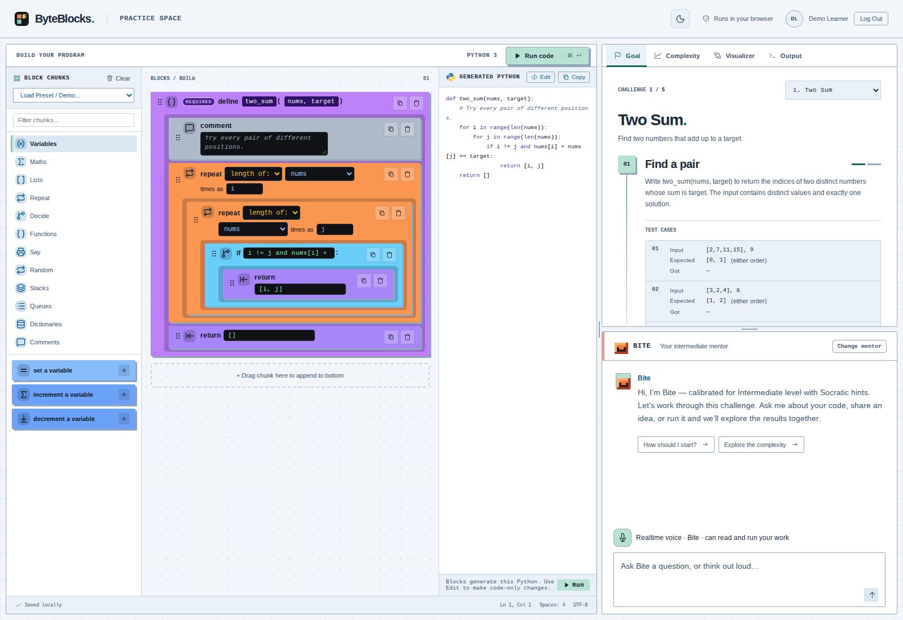
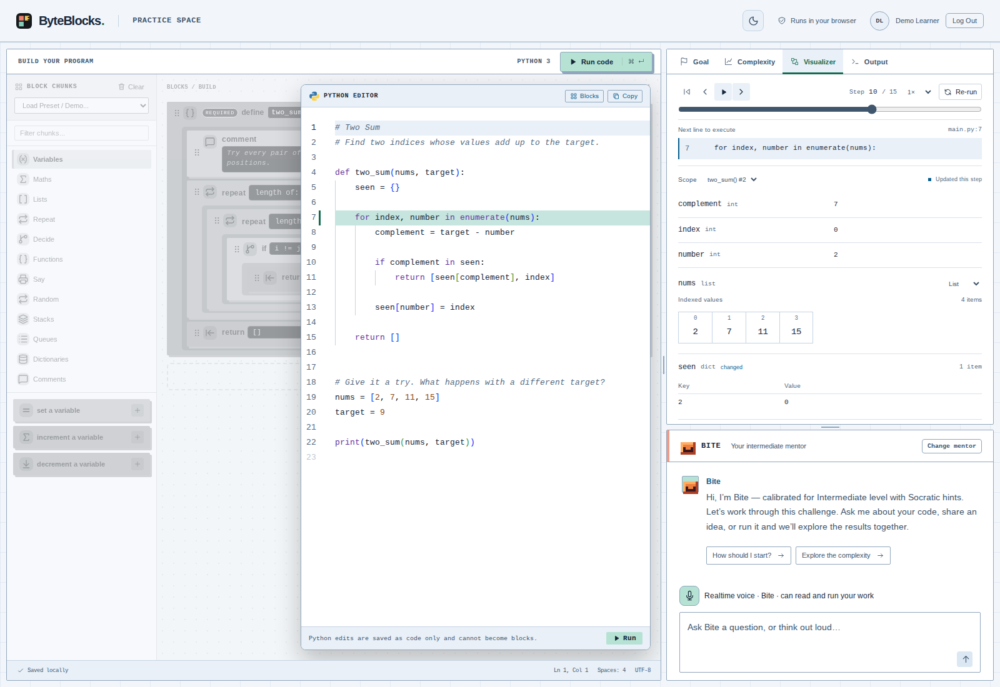

# ByteBlocks

**Think in blocks. Code in Python.**

ByteBlocks is a browser-based Python practice workspace. Build a program with visual blocks or edit Python directly, run it alongside the challenge, and explore what happens one step at a time. Nibble, Bite, and Chomp offer AI coaching tailored to your experience and learning preferences.

The app uses React, TypeScript, Vite, Monaco, and Pyodide to run Python in the browser.

## Key features

- **Blocks and Python:** build with visual blocks, then switch to a full Monaco code editor.
- **Browser-based execution:** run real Python with output, source-line errors, cancellation, and execution limits.
- **Execution replay:** step forward and backward through recorded runs, inspect variables and collections, and follow the highlighted source line.
- **Guided challenges:** work through stages, check your solution against test cases, and unlock further practice.
- **Personalized coaching:** get streaming text hints or talk to a voice mentor, with your code, challenge, and latest results as context.
- **A workspace that remembers:** autosave code and challenge progress locally, save coaching preferences to your account when configured, and choose light or dark mode.

## Demo

<video controls width="960" src="https://github.com/gh102003/ByteBlocks/raw/refs/heads/main/byteblocks/ByteBlocks-ad-v6-elevator-team.mp4">
  <a href="./byteblocks/ByteBlocks-ad-v6-elevator-team.mp4">Watch the 50-second ByteBlocks product demo</a>
</video>

[Watch or download the ByteBlocks product demo](./byteblocks/ByteBlocks-ad-v6-elevator-team.mp4)

### Build with blocks

Assemble a solution next to the current goal and its examples. The coach stays alongside your work.



### Follow the Python execution

Choose **Edit** above the generated Python, select **Run code**, then open **Visualizer** to replay the run and inspect how values change. **Output** shows printed results and errors.



## Run locally

### 1. Install dependencies

Use **Node.js 24** (the version used in CI) and npm. From the repository root:

```sh
cd byteblocks
npm ci
```

Run all frontend npm commands below from this `byteblocks/` directory.

### 2. Configure sign-in

```sh
cp .env.example .env.local
```

Edit `byteblocks/.env.local` and replace these placeholders with the public values from an **Auth0 Single Page Application**:

```dotenv
VITE_AUTH0_DOMAIN=your-tenant.eu.auth0.com
VITE_AUTH0_CLIENT_ID=your-spa-client-id
```

Auth0 is required to open the workspace. In the Auth0 application settings, add `http://localhost:5173` to **Allowed Callback URLs**, **Allowed Logout URLs**, and **Allowed Web Origins**. Enable **Refresh Token Rotation** and the **Refresh Token** grant type.

The other entries in `.env.example` configure optional services. Remove or leave unset any optional credentials you are not using, including the example `VITE_OPENAI_API_KEY`; placeholder keys do not connect the coach. Python editing, execution, challenges, and replay work without AI credentials after sign-in.

### 3. Start the app

```sh
npm run dev
```

Open the URL printed by Vite (normally `http://localhost:5173`), sign in, and choose your coaching preferences. If Vite uses a different port, add that exact origin to the Auth0 settings too.

Select a mentor manually or choose **Choose for me** for the skills check and automatic calibration. Open a challenge and message the coach, or select **Start voice** once ElevenLabs is configured and grant microphone access.

Use **Run code** or **Ctrl/⌘ + Enter** in the editor. Code and challenge progress save in this browser. Drag the dividers to resize the panels.

### Optional services

Configure these in `byteblocks/.env.local`, then restart Vite:

| Service                             | Configuration                                                                                                                                                                                                                                                               |
| ----------------------------------- | --------------------------------------------------------------------------------------------------------------------------------------------------------------------------------------------------------------------------------------------------------------------------- |
| Text coach for local development    | Set `VITE_OPENAI_API_KEY`. The default provider is `openai` and the default model is `gpt-4.1-mini`. `VITE_AI_BASE_URL` can override the Responses API base URL. This prototype mode exposes the key in the browser.                                                        |
| Coaching preferences across devices | Set `AUTH0_DOMAIN`, `AUTH0_MANAGEMENT_CLIENT_ID`, and `AUTH0_MANAGEMENT_CLIENT_SECRET` for an Auth0 Machine-to-Machine application with `read:users` and `update:users` permissions. Without this service, preferences fall back to account-scoped browser session storage. |
| Voice coach                         | Set server-only `ELEVENLABS_API_KEY` and `ELEVENLABS_AGENT_ID` for a private realtime agent. See the [voice setup guide](byteblocks/README.md#realtime-voice-coach) for provisioning and microphone access.                                                                 |

Keep real keys and `.env` files out of source control. Values prefixed with `VITE_` are included in the frontend bundle; Auth0 public application values belong there, while Management API and ElevenLabs secrets must stay server-side. Coaching sends conversation and workspace context to the configured provider.

## Build and preview

From `byteblocks/`, with your environment configured:

```sh
npm run build
npm run preview
```

`npm run build` checks TypeScript and produces the static site in **`byteblocks/dist/`**. `npm run preview` serves that build locally; open its printed URL (normally `http://localhost:4173`). Add the preview origin to the same three Auth0 URL settings before signing in.

Vite reads `VITE_*` configuration at startup and embeds it during the build. Restart the development server after changing it, and rebuild after any change intended for a static deployment.

### Deploy the frontend

Publish the contents of `byteblocks/dist/` to a static host over HTTP(S). Python's runtime assets are bundled with the site; execution needs no separate Python server or external CDN. Configure the deployed frontend origin in Auth0 as well.

For hosted text and voice coaching, follow the [Cloudflare Worker setup guide](cloudflare-worker/README.md). Set `VITE_WORKER_URL` and `VITE_AUTH0_AUDIENCE` before building the frontend, and leave `VITE_OPENAI_API_KEY` unset in that build. The Worker authenticates requests and keeps provider keys server-side.

The Vite development endpoints for `/api/auth/preferences` and `/api/voice/session` do **not** run in `npm run preview` or on a static host. The Worker supplies the voice endpoint; cross-device preference storage needs an equivalent authenticated server endpoint at `/api/auth/preferences`.

## Development checks

From `byteblocks/`:

```sh
npx playwright install chromium
npm test
npm run lint
npm run typecheck
npm run format:check
npm run build
```

Tests use Vitest Browser Mode and Playwright Chromium. They mock AI provider requests, so no paid API credentials are needed. If you override `PLAYWRIGHT_BROWSERS_PATH`, use the same value for browser installation and tests. On Linux, use `npx playwright install --with-deps chromium` if browser system dependencies are missing. Use `npm run test:watch` for watch mode.

See the [app documentation](byteblocks/README.md) for execution limits, sandbox isolation, and provider integration details, and the [Worker documentation](cloudflare-worker/README.md) for API deployment and Worker tests.
